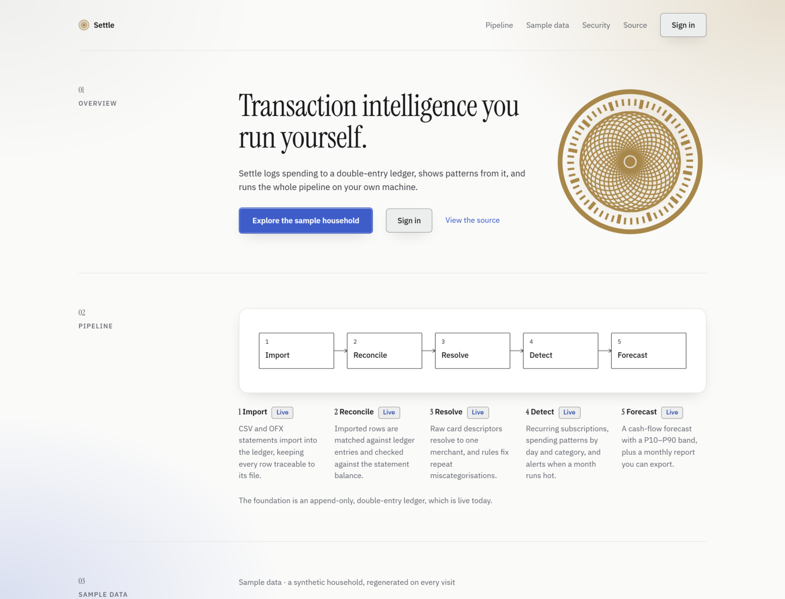
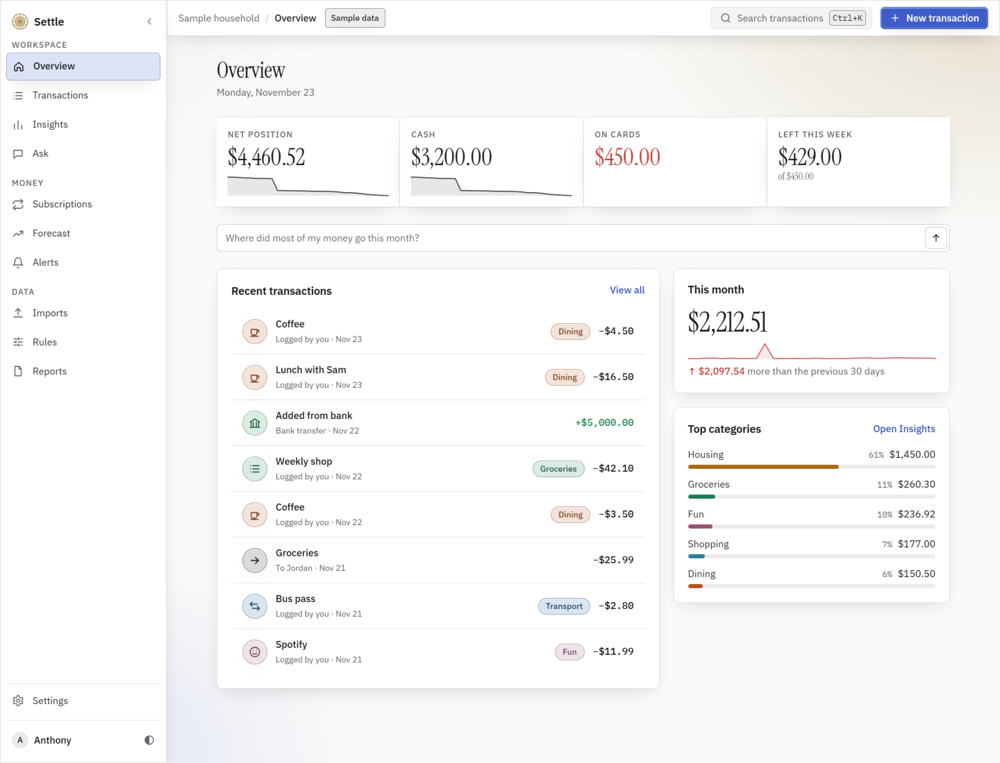
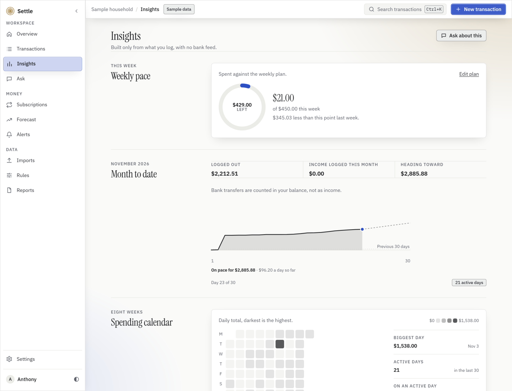
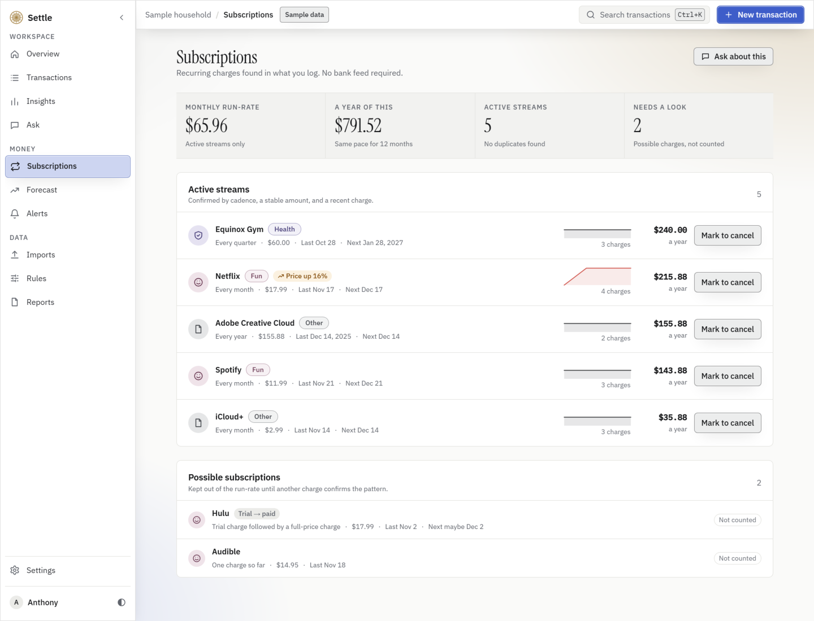
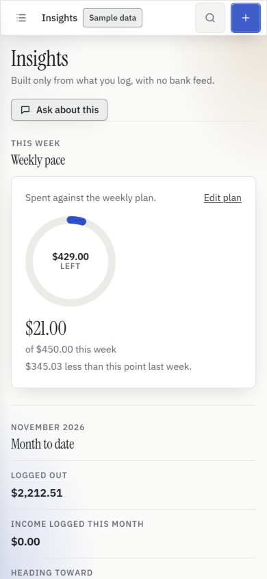
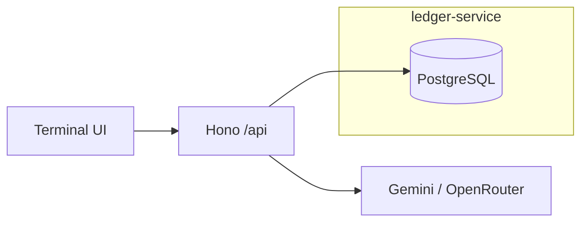
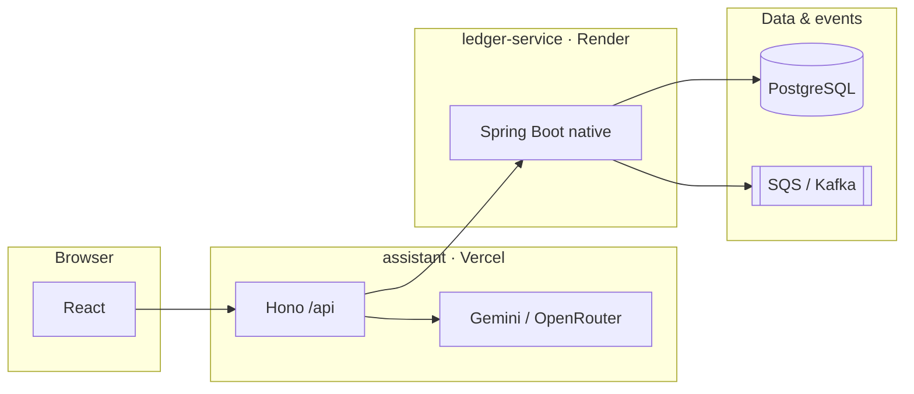

<h1 align="center">p2p-ledger</h1>

<p align="center">
  <em>Double-entry peer-to-peer payments where the ledger can prove itself.<br>
  Java and PostgreSQL underneath, a TypeScript product on top, an LLM that answers without touching money.</em>
</p>

<p align="center">
  <a href="https://ledger.anthony-zhou.com"><strong>Live demo</strong></a>
  ·
  <a href="docs/API.md">API</a>
  ·
  <a href="docs/ARCHITECTURE.md">Architecture</a>
  ·
  <a href="docs/BRIEFING.md">Ops briefing</a>
  ·
  <a href="docs/SECURITY.md">Security</a>
</p>

<p align="center">
  <a href="https://github.com/developer-az/p2p-ledger/actions/workflows/ledger-ci.yml"></a>
  <a href="https://github.com/developer-az/p2p-ledger/actions/workflows/assistant-ci.yml"></a>
  <a href="https://github.com/developer-az/p2p-ledger/actions/workflows/contracts-ci.yml"></a>
  
  
  
</p>

<p align="center">
  
</p>
<p align="center"><sub><strong>Settle</strong>, the app on top of the ledger: import a statement, reconcile it against a double-entry ledger, resolve merchants, detect recurring charges, and forecast the next 90 days — all from records you can open. Demo only, no real money. The original terminal lives at <code>/ops</code>.</sub></p>

<p align="center">
  <a href="#overview">Overview</a> ·
  <a href="#live-surfaces">Live surfaces</a> ·
  <a href="#the-settle-experience">Settle</a> ·
  <a href="#terminal-ui">Terminal</a> ·
  <a href="#system-context">Architecture</a> ·
  <a href="#quick-start">Quick start</a> ·
  <a href="#engineering-notes">Engineering notes</a>
</p>

---

## Overview

| | |
|---|---|
| **Problem** | P2P money needs one source of truth: correct balances under concurrency, safe retries, auditable history, explainable declines. |
| **Approach** | `ledger-service` (Spring Boot + PostgreSQL) is the system of record. `assistant` is the product: a consumer **Settle** app with an overview (net position, cash, cards, weekly pace), **two-tap spend logging**, CSV/OFX **imports** with merchant **rules**, **Insights** over your own records, **subscription detection**, a 90-day **forecast**, and read-only **LLM tools**. P2P endpoints remain in the API and `/ops`, but the consumer app is focused on spending habits. |
| **Scope** | End-to-end portfolio system: Docker, native-image CI, Render + Vercel deploy path, k6 load tests, integration tests. Not a licensed bank — [SECURITY.md](docs/SECURITY.md). |

## Java workflows and chain receipts

Live bill splits, payment-request settlement, spending records and expense CSV import now run in `ledger-service`. Paying a request locks it and commits its status, ledger entries, retry result and event together; a racing cancel or external-settlement action cannot leave the request book disagreeing with the money movement. TypeScript keeps the UI, session authorization, read-only assistant and practice fixtures.

In **Imports**, upload a CSV or OFX statement, map its columns, and review every row before it reaches Transactions. Java validates the complete file before committing. Reimporting the same file skips duplicates; a stable `transactionId` also detects overlaps across statements. Expense logs do not move money, and **Rules** turns the resulting descriptors into one visible merchant → category decision. See [Java workflows and rollout](docs/JAVA-WORKFLOWS.md).

The optional **Solidity registry** records immutable receipts for completed Java transfers. The Java relay checks the deployed bytecode and chain IDs, bounds gas and retries, and waits for finalized contract storage. Activity can download the receipt for independent verification. This is an attestation integration; funding remains simulated. Setup, tests, deployment roles and release boundaries: [contracts/README.md](contracts/README.md).

Live workflows require the same random 32+ character `LEDGER_API_KEY` on Java and the assistant server. Docker Compose requires it too; provide it through the shell or a local ignored root `.env`. Keep it server-side and never use a `VITE_` prefix. Roll out the Java migrations before the matching BFF changes.

## Live surfaces

| Surface | URL / config |
|---------|----------------|
| **Assistant** (UI + `/api`) | [ledger.anthony-zhou.com](https://ledger.anthony-zhou.com) · alias [p2p-ledger-pi.vercel.app](https://p2p-ledger-pi.vercel.app) |
| **Ledger API** | Render service → Vercel `LEDGER_URL` |

**Try it:** open the live app and choose **Explore the sample household** — a fixed, synthetic household seeded on read, with no sign-in and nothing written to your own records (or **F2 ONBOARD** in `/ops` when a live ledger is attached). The five-step tour covers Overview, Transactions, Insights, the command palette and appearance settings, then steps out of the way. Sign in to start your own wallet: set cash, cards and a weekly pace once, then log a spend in two taps. Setup: [DEVELOPMENT.md](docs/DEVELOPMENT.md) · Troubleshooting: [BRIEFING.md](docs/BRIEFING.md).

## The Settle experience

| Section | What it answers |
|---------|-----------------|
| **Overview** | What is my net position, what is left this week, what did I just spend, and where did this month go? |
| **Transactions** | Every payment, logged spend and imported row in date order — filter by kind, search a name or note, open a row for detail. |
| **Insights** | Weekly pace, month to date, an eight-week spending calendar, the daily trend, categories, weekday rhythm, and a card payoff plan. |
| **Subscriptions** | Which charges recur, what they cost a month and a year, which one raised its price, and which are trials or near-duplicates. |
| **Forecast** | Cash out to 90 days, the low point, and the assumptions under the line. |
| **Ask** | Read-only questions about your records; the assistant cannot move money. |
| **Imports, Rules, Reports** | CSV/OFX statements with column mapping and dedupe; merchant → category rules with a preview; month-over-month reports. |

<p align="center">
  
  
</p>
<p align="center"><sub><strong>Overview</strong> — four numbers, the recent list, and where the month went. <strong>Insights</strong> — the pace you set, the month so far, and the days you actually spent.</sub></p>

<p align="center">
  
  
</p>
<p align="center"><sub><strong>Subscriptions</strong> finds the recurring charges in what you log and flags a price rise. The same figures hold up on a phone.</sub></p>

The design rules: **three numbers to start** (net position, cash, cards — with the weekly plan beside them), **two taps to log** (amount + category, with recent repeats and undo), and **no mixing** between user logs and ledger transfers. Imported rows are statement facts; logged spends are yours; habit totals never pretend to be a bank feed.

**The sample is a guided tour, not a sandbox.** It loads a believable personal history — statements, logs, subscriptions, a peer transfer — and opens a five-step rail: overview figures, the transactions list, the insight charts, the command palette, appearance settings. Each step points at a real anchor and the route follows along. **Guided tour** in the account menu reopens it; **Exit sample** leaves the demo.

**Your wallet is isolated from the demo.** Creating an account opens a new ledger account that **starts empty** — no simulated deposit, no fake first payment. The setup sheet collects your own cash, cards, and weekly pace, and the account starts with no spend logs, no sample household, and no tour progress. In live mode the wallet persists in PostgreSQL; in practice mode it lives in memory.


## Terminal UI

`/ops` keeps the original engineering console. It signs in against a live wallet,
so it is not part of the sample household tour.

| Pane | Purpose |
|------|---------|
| **SNAPSHOT** | Balance, 30-day in/out, peers, the **bank dock** (ACH IN/OUT, +DEP) and exports. |
| **ACTIVITY** | Logged spends, income and ledger transfers in one feed; open a row for ledger detail. |
| **ASK** | Read-only questions about the wallet, plus the company-wide integrity check. |

Shortcuts: **F1** help · **F2** demo/onboard · **F3** ledger integrity. The same commands work from the CMD bar:
`pay sam 10 lunch`, `split 50 sam dinner`, `bank in`, `log 15 groceries`.



### Simulated bank (same ledger)

`bank-sim` models ACH-style flows without a second database: each corridor **opens a counterparty wallet**, posts deposits/transfers, then leaves the peer in **PEERS** as history. Accounts start empty at signup; **`/api/bank/welcome`** ($500 + one inbound corridor) is an explicit simulator action (ops console), never called by registration.

## System context



| Component | Role | Stack |
|-----------|------|--------|
| **ledger-service** | Accounts, transfers, fraud, outbox | Java 21, Spring Boot 4, GraalVM native |
| **assistant** | UI, BFF, chat tools | React, Vite, Hono, TypeScript |
| **CI/CD** | Test, image, deploy | GitHub Actions, Render, Vercel |

Transfer path: idempotency → row locks (PK order) → fraud + balance → double-entry + outbox in one transaction. [ARCHITECTURE.md](docs/ARCHITECTURE.md).

## Quick start

Prerequisites: **Node 22+**, **Docker** (live ledger), **Java 21** + `./mvnw` (ledger tests). [DEVELOPMENT.md](docs/DEVELOPMENT.md).

```bash
# Practice UI only (in-memory ledger) — first time setup in assistant/
cd assistant && cp .env.example .env.local && npm install
npm run dev              # from repo root, or: cd assistant && npm run dev

# Live ledger + terminal (recommended)
npm run dev:stack        # from repo root, or: cd assistant && npm run dev:stack

# Tests
cd ledger-service && ./mvnw verify
cd assistant && npm test && npm run build
```

Smoke the deployed app: `cd assistant && npm run smoke:api -- https://p2p-ledger-pi.vercel.app`

## Assistant API

Browser → **`/api/*` only**. Live traffic uses `ledger-service` when healthy; otherwise **practice** mode. Notable routes: `/api/peers`, `/api/peer-ledger`, `/api/bank/*`, `/api/demo` (live seed), `/api/demo/practice` (guided practice seed), `/api/chat` (read-only tools). OpenAPI: [assistant/openapi.yaml](assistant/openapi.yaml).

**Quality:** 80+ Vitest tests in CI; optional Gemini evals via Actions ([GITHUB.md](docs/GITHUB.md)).

## Deployment

```
GitHub Actions → tests → native image → GHCR → Render
Vercel (assistant/) → LEDGER_URL, GEMINI_API_KEY / OPENROUTER_*
PostgreSQL (Supabase) · SQS FIFO optional (infra/aws)
```

Checklist: [GITHUB.md](docs/GITHUB.md).

## Repository map

| Path | Contents |
|------|----------|
| `ledger-service/` | Java ledger, migrations, native build |
| `assistant/` | Terminal UI, Hono API, evals |
| `infra/aws/` | SQS, IAM, budget alarm |
| `loadtest/` | k6 |
| `docs/` | Architecture, API, briefing, images |

## Roadmap

- [x] Ledger core, fraud, outbox, native CI/CD
- [x] Terminal UI, bank sim, peers, LLM tools, evals
- [x] Ops briefing and README figures
- [ ] Owner prefix search (Java)
- [ ] OAuth / session-bound wallets
- [x] On-chain attestation registry — local chain and integration test; no public deployment yet ([contracts](contracts/README.md), [notes](docs/P2P-SOLIDITY-AND-SCALE.md))

## Engineering notes

Native image ~3.6s cold start vs ~144s JVM on 0.1 CPU (see [ARCHITECTURE.md](docs/ARCHITECTURE.md)). Load tests drove in-flight limits and GraalVM-native event-sink wiring. Metrics are reproducible from scripts in-repo.
