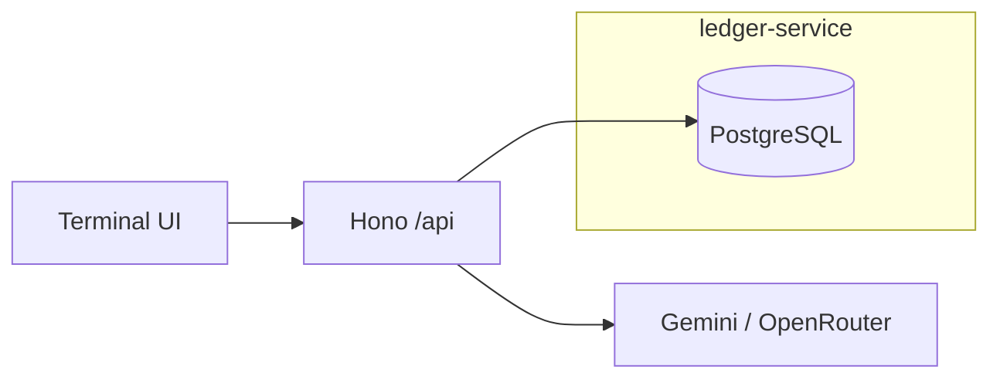
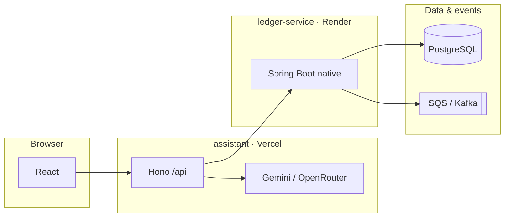

# p2p-ledger

**Production-style peer-to-peer payments ledger with an LLM support layer** — double-entry money movement in Java, a TypeScript terminal and BFF, and deterministic evals over real account data.

<p align="center">
  <a href="https://p2p-ledger-pi.vercel.app"><strong>Live demo</strong></a>
  ·
  <a href="docs/API.md">API</a>
  ·
  <a href="docs/ARCHITECTURE.md">Architecture</a>
  ·
  <a href="docs/BRIEFING.md">Ops briefing</a>
</p>

<p align="center">
  <a href="https://github.com/developer-az/p2p-ledger/actions/workflows/ledger-ci.yml"></a>
  <a href="https://github.com/developer-az/p2p-ledger/actions/workflows/assistant-ci.yml"></a>
</p>

<p align="center">
  
</p>
<p align="center"><sub>Terminal workstation on live PostgreSQL · <a href="https://p2p-ledger-pi.vercel.app">open demo</a> · F2 ONBOARD to seed wallets</sub></p>

---

## Overview

| | |
|---|---|
| **Problem** | P2P money needs one source of truth: correct balances under concurrency, safe retries, auditable history, explainable declines. |
| **Approach** | `ledger-service` (Spring Boot + PostgreSQL) is the system of record. `assistant` is the product: Bloomberg-style **terminal UI**, Hono **`/api` BFF**, **simulated bank corridors**, **peer lane**, and read-only **LLM tools** on the signed-in wallet. |
| **Scope** | End-to-end portfolio system: Docker, native-image CI, Render + Vercel deploy path, k6 load tests, integration tests. Not a licensed bank — [SECURITY.md](docs/SECURITY.md). |

## Live surfaces

| Surface | URL / config |
|---------|----------------|
| **Assistant** (UI + `/api`) | [p2p-ledger-pi.vercel.app](https://p2p-ledger-pi.vercel.app) |
| **Ledger API** | Render service → Vercel `LEDGER_URL` |

**Try it:** open the demo → **F2 ONBOARD** (live Postgres when `LEDGER_URL` is set) or resume a saved wallet. Command line: `pay sam 10 lunch`, `bank in`, **F3** company audit. Setup: [DEVELOPMENT.md](docs/DEVELOPMENT.md) · Troubleshooting: [BRIEFING.md](docs/BRIEFING.md).

## Terminal UI

Three panes plus a fixed **CMD** bar:

| Pane | Purpose |
|------|---------|
| **WATCH** | Balance, 30-day flow (deposits vs peer inflow), peer chips, **bank dock** (ACH IN/OUT, +DEP, export) |
| **BLOTTER** | Transfers; click a row to expand/collapse ledger detail |
| **AUDIT / MSG** | Company-wide integrity (F3) and AI Q&A via CMD |

Shortcuts: **F1** help · **F2** onboard · **F3** audit · **F4** idempotency race.



### Simulated bank (same ledger)

`bank-sim` models ACH-style flows without a second database: each corridor **opens a counterparty wallet**, posts deposits/transfers, then leaves the peer in **PEERS** as history. New wallets get **`/api/bank/welcome`** ($500 + one inbound corridor).

## System context



| Component | Role | Stack |
|-----------|------|--------|
| **ledger-service** | Accounts, transfers, fraud, outbox | Java 21, Spring Boot 4, GraalVM native |
| **assistant** | UI, BFF, chat tools | React, Vite, Hono, TypeScript |
| **CI/CD** | Test, image, deploy | GitHub Actions, Render, Vercel |

Transfer path: idempotency → row locks (PK order) → fraud + balance → double-entry + outbox in one transaction. [ARCHITECTURE.md](docs/ARCHITECTURE.md).

## Quick start

Prerequisites: **Node 22+**, **Docker** (live ledger), **Java 21** + `./mvnw` (ledger tests). [DEVELOPMENT.md](docs/DEVELOPMENT.md).

```bash
# Practice UI only (in-memory ledger)
cd assistant && cp .env.example .env.local && npm install && npm run dev

# Live ledger + terminal (recommended)
cd assistant && npm run dev:stack

# Tests
cd ledger-service && ./mvnw verify
cd assistant && npm test && npm run build
```

Smoke the deployed app: `cd assistant && npm run smoke:api -- https://p2p-ledger-pi.vercel.app`

## Assistant API

Browser → **`/api/*` only**. Live traffic uses `ledger-service` when healthy; otherwise **practice** mode. Notable routes: `/api/peers`, `/api/peer-ledger`, `/api/bank/*`, `/api/chat` (read-only tools). OpenAPI: [assistant/openapi.yaml](assistant/openapi.yaml).

**Quality:** 80+ Vitest tests in CI; optional Gemini evals via Actions ([GITHUB.md](docs/GITHUB.md)).

## Deployment

```
GitHub Actions → tests → native image → GHCR → Render
Vercel (assistant/) → LEDGER_URL, GEMINI_API_KEY / OPENROUTER_*
PostgreSQL (Supabase) · SQS FIFO optional (infra/aws)
```

Checklist: [GITHUB.md](docs/GITHUB.md).

## Repository map

| Path | Contents |
|------|----------|
| `ledger-service/` | Java ledger, migrations, native build |
| `assistant/` | Terminal UI, Hono API, evals |
| `infra/aws/` | SQS, IAM, budget alarm |
| `loadtest/` | k6 |
| `docs/` | Architecture, API, briefing, images |

## Roadmap

- [x] Ledger core, fraud, outbox, native CI/CD
- [x] Terminal UI, bank sim, peers, LLM tools, evals
- [x] Ops briefing and README figures
- [ ] Owner prefix search (Java)
- [ ] OAuth / session-bound wallets
- [ ] On-chain attestation bridge (optional) — [P2P-SOLIDITY-AND-SCALE.md](docs/P2P-SOLIDITY-AND-SCALE.md)

## Engineering notes

Native image ~3.6s cold start vs ~144s JVM on 0.1 CPU (see [ARCHITECTURE.md](docs/ARCHITECTURE.md)). Load tests drove in-flight limits and GraalVM-native event-sink wiring. Metrics are reproducible from scripts in-repo.
