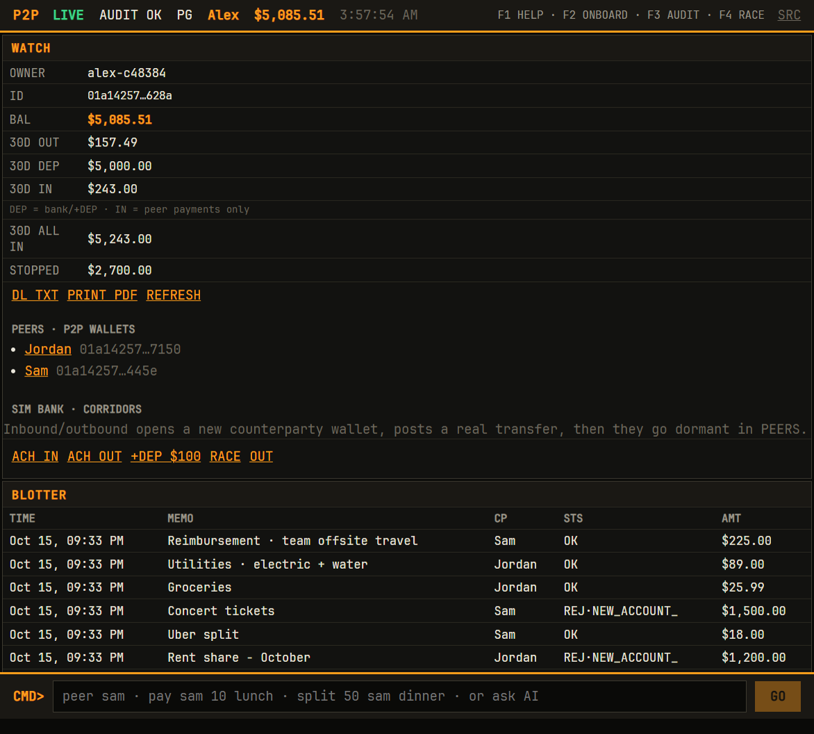
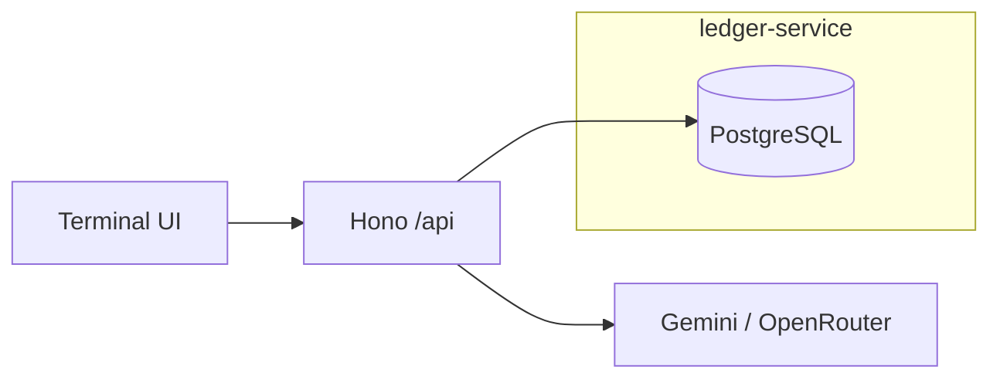
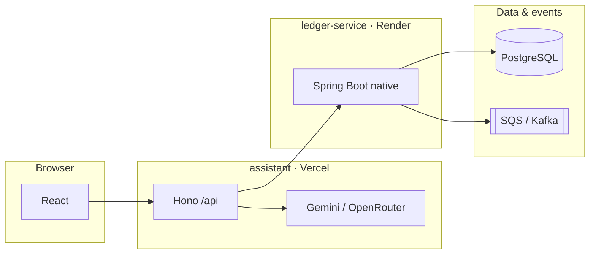

# p2p-ledger

A peer-to-peer payments ledger. People send each other money, every balance can be proven from its history, and when a payment is declined an assistant explains why in plain words.

<p align="center">
  <a href="https://ledger.anthony-zhou.com"><strong>Live demo</strong></a>
  ·
  <a href="docs/API.md">API</a>
  ·
  <a href="docs/ARCHITECTURE.md">Architecture</a>
  ·
  <a href="docs/BRIEFING.md">Ops briefing</a>
</p>

<p align="center">
  <a href="https://github.com/developer-az/p2p-ledger/actions/workflows/ledger-ci.yml"></a>
  <a href="https://github.com/developer-az/p2p-ledger/actions/workflows/assistant-ci.yml"></a>
</p>

<p align="center">
  
</p>

## Why I built it

At allBETs, a peer-to-peer payments startup, I tested the payment and fraud checks before the iOS launch. I saw those checks from the outside, and I wanted to build what sits underneath them: the ledger, and what it takes to keep money correct when many requests hit the same accounts at once.

I study Information Science with a minor in Information Risk Management, Ethics, and Privacy, so the audit trail and the explanations mattered to me as much as the transfers. Someone whose payment failed should be able to ask why and get an answer pulled from their own records.

## What it does

- **Moves money with double-entry bookkeeping.** Every transfer writes a debit and a matching credit in one database transaction. Database triggers reject any entry that does not balance or that tries to edit history.
- **Survives retries and races.** A repeated request with the same idempotency key returns the first result instead of charging twice. Account locks are always taken in the same order, so two opposite transfers cannot deadlock.
- **Checks for fraud and records why.** Risky transfers are declined with a stored reason the assistant can read back.
- **Never loses an event.** Each transfer is written to an outbox table in the same transaction and then published to Kafka or AWS SQS, so no message goes out for a transfer that rolled back.
- **Explains itself.** A TypeScript assistant answers balance and declined-payment questions with read-only tools over the signed-in wallet.

## What broke, and what I changed

- **Out of memory under load.** A k6 load test ran the 512 MB server out of memory at 500 requests a second. It now caps work in flight and returns 503 when full, so it slows down instead of crashing.
- **The model ran out of quota.** On the free Gemini tier the assistant hit quota and rate limits. It now answers balance and decline questions straight from the ledger when the model is unavailable, waits out rate limits, and retries a ledger server that is waking from sleep.
- **Slow cold starts.** The JVM took about 144 seconds to start on the free host's 0.1 CPU. A GraalVM native image starts in about 3.6 seconds.

## How it was built

I designed it and built it with Claude Code and Cursor. The ledger core came out of a Claude Code session I directed; the assistant's fallback and retry work are my own commits.

It is a portfolio system, not a licensed bank. See [SECURITY.md](docs/SECURITY.md).

## Terminal UI

Three panes plus a fixed **CMD** bar:

| Pane | Purpose |
|------|---------|
| **WATCH** | Balance, 30-day flow (deposits vs peer inflow), peer chips, **bank dock** (ACH IN/OUT, +DEP, export) |
| **BLOTTER** | Transfers; click a row to expand/collapse ledger detail |
| **AUDIT / MSG** | Company-wide integrity (F3) and AI Q&A via CMD |

Shortcuts: **F1** help · **F2** onboard · **F3** audit · **F4** idempotency race.



### Simulated bank (same ledger)

`bank-sim` models ACH-style flows without a second database: each corridor **opens a counterparty wallet**, posts deposits/transfers, then leaves the peer in **PEERS** as history. New wallets get **`/api/bank/welcome`** ($500 + one inbound corridor).

## System context



| Component | Role | Stack |
|-----------|------|--------|
| **ledger-service** | Accounts, transfers, fraud, outbox | Java 21, Spring Boot 4, GraalVM native |
| **assistant** | UI, BFF, chat tools | React, Vite, Hono, TypeScript |
| **CI/CD** | Test, image, deploy | GitHub Actions, Render, Vercel |

Transfer path: idempotency → row locks (PK order) → fraud + balance → double-entry + outbox in one transaction. [ARCHITECTURE.md](docs/ARCHITECTURE.md).

## Quick start

Prerequisites: **Node 22+**, **Docker** (live ledger), **Java 21** + `./mvnw` (ledger tests). [DEVELOPMENT.md](docs/DEVELOPMENT.md).

```bash
# Practice UI only (in-memory ledger)
cd assistant && cp .env.example .env.local && npm install && npm run dev

# Live ledger + terminal (recommended)
cd assistant && npm run dev:stack

# Tests
cd ledger-service && ./mvnw verify
cd assistant && npm test && npm run build
```

Smoke the deployed app: `cd assistant && npm run smoke:api -- https://p2p-ledger-pi.vercel.app`

## Assistant API

Browser → **`/api/*` only**. Live traffic uses `ledger-service` when healthy; otherwise **practice** mode. Notable routes: `/api/peers`, `/api/peer-ledger`, `/api/bank/*`, `/api/chat` (read-only tools). OpenAPI: [assistant/openapi.yaml](assistant/openapi.yaml).

**Quality:** 80+ Vitest tests in CI; optional Gemini evals via Actions ([GITHUB.md](docs/GITHUB.md)).

## Deployment

```
GitHub Actions → tests → native image → GHCR → Render
Vercel (assistant/) → LEDGER_URL, GEMINI_API_KEY / OPENROUTER_*
PostgreSQL (Supabase) · SQS FIFO optional (infra/aws)
```

Checklist: [GITHUB.md](docs/GITHUB.md).

## Repository map

| Path | Contents |
|------|----------|
| `ledger-service/` | Java ledger, migrations, native build |
| `assistant/` | Terminal UI, Hono API, evals |
| `infra/aws/` | SQS, IAM, budget alarm |
| `loadtest/` | k6 |
| `docs/` | Architecture, API, briefing, images |

## Roadmap

- [x] Ledger core, fraud, outbox, native CI/CD
- [x] Terminal UI, bank sim, peers, LLM tools, evals
- [x] Ops briefing and README figures
- [ ] Owner prefix search (Java)
- [ ] OAuth / session-bound wallets
- [ ] On-chain attestation bridge (optional): [P2P-SOLIDITY-AND-SCALE.md](docs/P2P-SOLIDITY-AND-SCALE.md)

## Engineering notes

Native image ~3.6s cold start vs ~144s JVM on 0.1 CPU (see [ARCHITECTURE.md](docs/ARCHITECTURE.md)). Load tests drove in-flight limits and GraalVM-native event-sink wiring. Metrics are reproducible from scripts in-repo.
