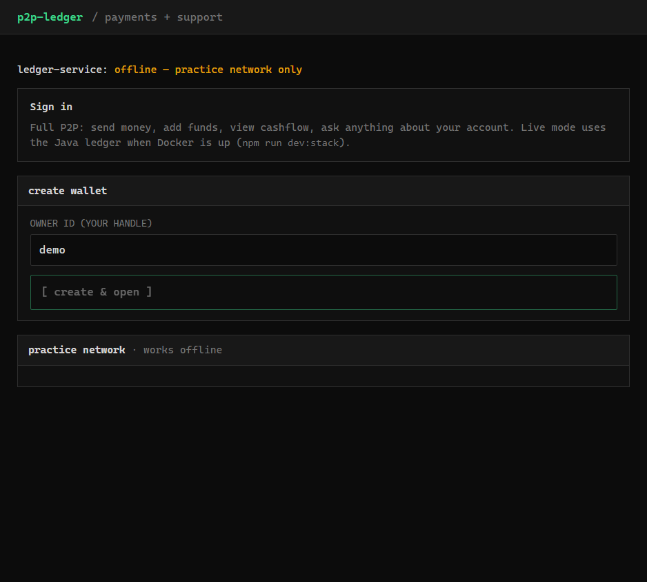
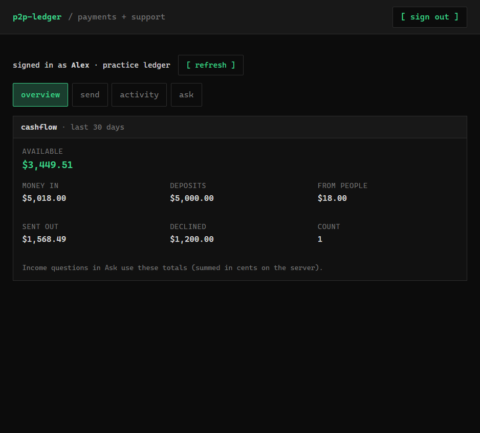
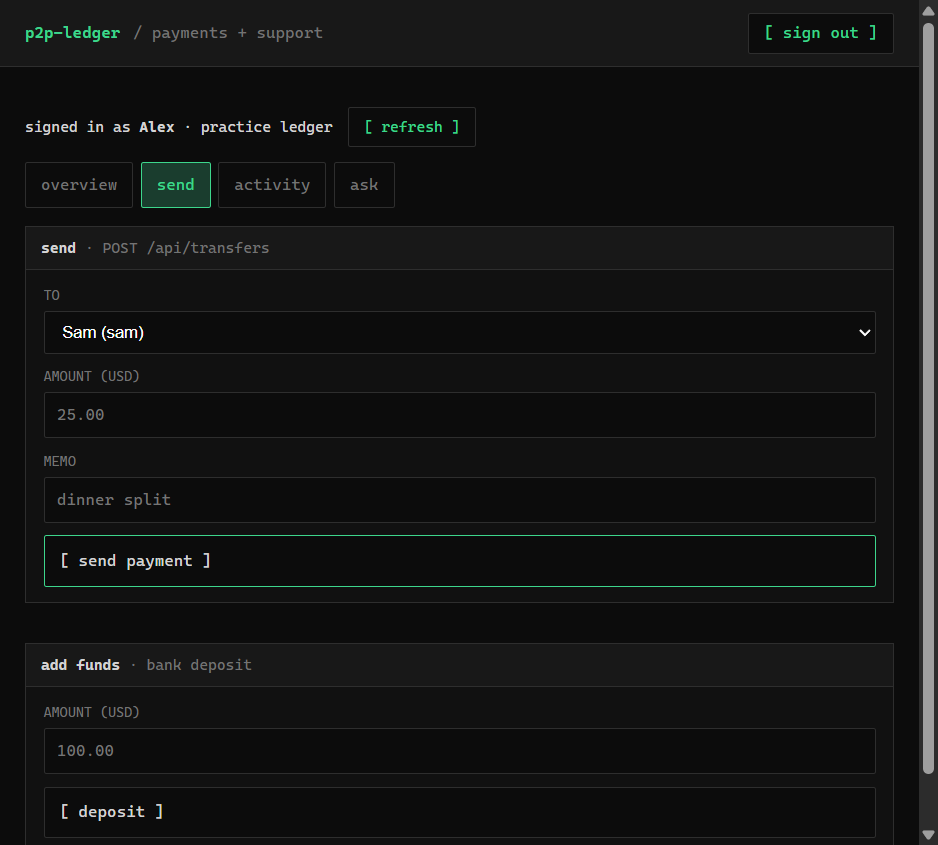
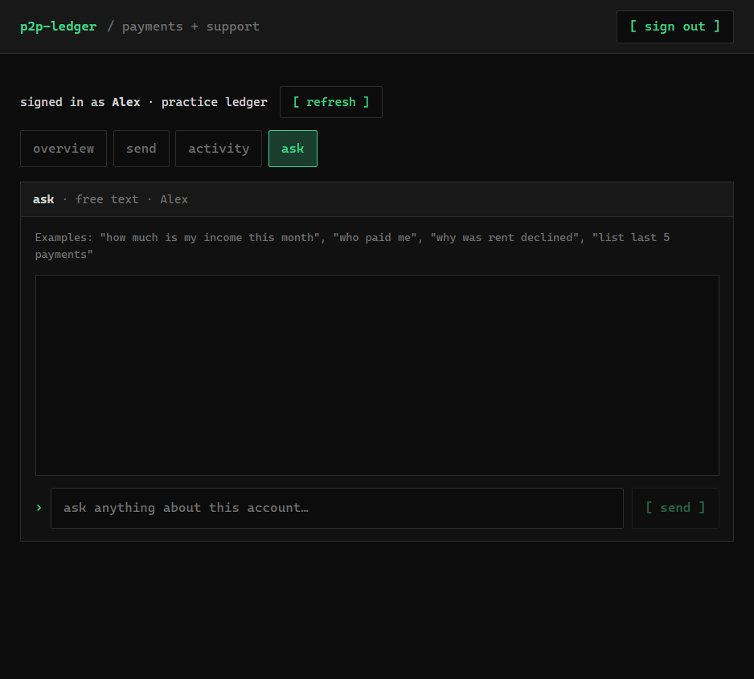
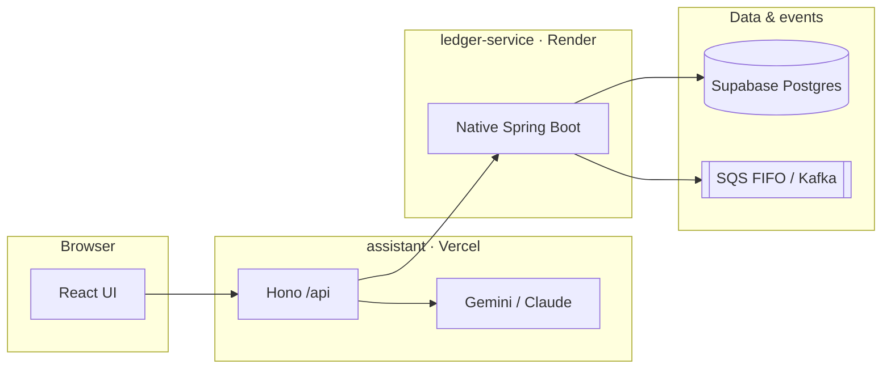

# p2p-ledger

**A production-style peer-to-peer payments ledger with an LLM support layer** — double-entry money movement in Java, a TypeScript app API and UI, and deterministic evals over real account data.

<p align="center">
  <a href="https://p2p-ledger-pi.vercel.app"><strong>Live assistant</strong></a>
  ·
  <a href="docs/API.md">API reference</a>
  ·
  <a href="docs/ARCHITECTURE.md">Ledger deep-dive</a>
</p>

<p align="center">
  <a href="https://github.com/developer-az/p2p-ledger/actions/workflows/ledger-ci.yml"></a>
  <a href="https://github.com/developer-az/p2p-ledger/actions/workflows/assistant-ci.yml"></a>
</p>

---

## Overview

**Problem.** Moving money between people needs a single source of truth: balances that stay correct under concurrency, safe retries, auditable history, and explainable declines — not ad hoc balances in an app server.

**Approach.** `ledger-service` implements that core as a Spring Boot service on PostgreSQL (idempotent transfers, row-level locking, fraud rules, transactional outbox). `assistant` is the product surface: React UI, Hono `/api` BFF, and read-only LLM tools bound to the signed-in wallet. Writes (send, deposit) go through explicit HTTP routes that proxy the Java API.

**Scope.** This repo is an end-to-end system: Docker local stack, native-image CI, $0 deployment path (Render, Supabase, SQS via Terraform, Vercel for the UI), load tests, and property-style integration tests. It is a **demo / portfolio** deployment, not a regulated bank — see [docs/SECURITY.md](docs/SECURITY.md).

## Live demo

| Surface | URL |
|---|---|
| **Assistant (UI + `/api`)** | [p2p-ledger-pi.vercel.app](https://p2p-ledger-pi.vercel.app) |
| **Ledger API** | Your Render `LEDGER_URL` (set in Vercel env for live mode) |

Open the assistant → use **practice accounts** (Alex / Sam / Jordan) for a full flow without Docker, or connect `LEDGER_URL` for the Java ledger on Render.

### Product screenshots

Captured from the deployed sign-in screen and the running assistant (practice ledger).

<p align="center">
  
</p>

<table align="center">
  <tr>
    <td align="center"><br><sub>Overview · 30-day cashflow</sub></td>
    <td align="center"><br><sub>Send · P2P + deposit</sub></td>
  </tr>
  <tr>
    <td colspan="2" align="center"><br><sub>Ask · LLM over ledger tools (read-only)</sub></td>
  </tr>
</table>

## System context



| Component | Role | Stack |
|---|---|---|
| **ledger-service** | System of record — accounts, transfers, fraud, outbox | Java 21, Spring Boot 4, PostgreSQL, GraalVM native, Kafka / SQS |
| **assistant** | App API, UI, support chat | React, Vite, Hono, TypeScript, Vitest |
| **CI/CD** | Test, native image → GHCR, deploy hooks | GitHub Actions, Render, Vercel |

Transfer path (simplified): idempotency check → lock accounts in PK order → fraud + balance → double-entry rows + outbox in one transaction. Details: [docs/ARCHITECTURE.md](docs/ARCHITECTURE.md).

## Quick start

**Ledger only (Docker)**

```bash
docker compose up --build    # Postgres, Kafka, ledger :8080
```

**Full stack (ledger + assistant image)**

```bash
docker compose up --build    # adds assistant :8787
```

**Assistant dev (practice ledger, no Docker)**

```bash
cd assistant && cp .env.example .env.local   # optional GEMINI_API_KEY for chat
npm install && npm run dev                   # UI :5173, /api embedded
```

**Assistant + live ledger**

```bash
cd assistant && npm run dev:stack            # Docker ledger + Vite UI
```

**Tests**

```bash
cd ledger-service && ./mvnw verify           # integration + concurrency (Docker)
cd assistant && npm test                     # 29 unit tests, no API key
```

## Assistant layer

The browser talks only to **`/api/*`**. That layer:

- Routes **live** traffic to `ledger-service` when `LEDGER_URL` is healthy.
- Falls back to an in-memory **practice** network for offline demos.
- Exposes **chat** with tools scoped to the session account (no send-money tool; P2P uses `POST /api/transfers`).

OpenAPI: [assistant/openapi.yaml](assistant/openapi.yaml) · Integration map: [docs/API.md](docs/API.md).

**Quality**

- **Unit tests** — tools, graders, practice ledger, HTTP API with a scripted model (CI gate).
- **Evals** — 8 deterministic cases over a fixture ledger; run locally or via **Actions → assistant eval (Gemini)** when free-tier quota allows ([docs/GITHUB.md](docs/GITHUB.md)).

## Deployment ($0)

```
GitHub Actions → tests → native image → GHCR → Render deploy hook
Render (native) → Supabase Postgres
               → AWS SQS FIFO (Terraform in infra/aws)
Vercel (assistant/) → LEDGER_URL + GEMINI_API_KEY
```

| Piece | Choice |
|---|---|
| Compute | Render free web service (native image, 0.1 CPU) |
| Database | Supabase Postgres (session pooler) |
| Events | SQS FIFO (`infra/aws`) or Kafka locally |
| UI | Vercel (`assistant/`, `api/index.ts` + `/api/*` rewrite) |
| Keep-warm | `keep-warm.yml` → `LEDGER_URL` / optional `ASSISTANT_URL` |

Setup checklist: [docs/GITHUB.md](docs/GITHUB.md) · Security model: [docs/SECURITY.md](docs/SECURITY.md).

## Repository map

| Path | Contents |
|---|---|
| `ledger-service/` | Java ledger, migrations, native build |
| `assistant/` | UI, Hono API, evals, Vercel config |
| `infra/aws/` | SQS, IAM, budget alarm |
| `loadtest/` | k6 transfer workload |
| `docs/` | Architecture, API, GitHub setup, screenshots |

## Engineering notes

- **Performance:** Native image ~3.6s startup vs ~144s JVM on 0.1 CPU; k6 tables in [docs/ARCHITECTURE.md](docs/ARCHITECTURE.md).
- **AI-assisted development:** Implementation and benchmarks were built with AI coding tools under author review; load tests exposed JVM OOM under virtual-thread burst; native smoke caught frozen `@ConditionalOnProperty` for event sinks. Metrics in docs are reproduced from scripts in-repo.

## Roadmap

- [x] Ledger core, fraud, outbox, CI, native deploy pipeline
- [x] Assistant: P2P UI, BFF API, tool-calling chat, evals
- [x] Public demo + documentation screenshots
- [ ] OAuth and session-bound wallets for a non-demo deployment
